# b4d: fast noise-bounded compression of scientific camera images

b4d compresses images from scientific cameras within the noise limit: the information it discards lies inside the
noise the camera itself records, so every reconstructed pixel stays within half a standard deviation of its own
noise. At that bound b4d reaches the compression ratios of lossy codecs (6- to 9-fold on recorded data) at the speed
of lossless codecs (about 800 MB/s per core, 80 GB/s on a 128-core CPU, 22 GB/s per GPU). This makes it uniquely
suited to compression at acquisition, on data streaming from cameras at full rate, with no anticipated impact on
downstream analysis. b4d includes a native sharded zarr v3 writer, CPU and GPU encoders with identical output, and a
zero-copy interface to example camera drivers.

**Contents**

- [Overview](#overview)
- [How it works](#how-it-works)
  - [1. Noise model and variance stabilization](#1-noise-model-and-variance-stabilization)
  - [2. Data layout and example chunk](#2-data-layout-and-example-chunk)
  - [3. Encoding](#3-encoding)
  - [4. Container format](#4-container-format)
  - [5. Decoding and reconstruction error](#5-decoding-and-reconstruction-error)
  - [6. Rate–distortion: the quantization step q](#6-ratedistortion-the-quantization-step-q)
- [Notation](#notation)
- [Install](#install)
  - [Linux](#linux)
  - [macOS (Apple Silicon or Intel)](#macos-apple-silicon-or-intel)
  - [Windows](#windows)
  - [GPU support](#gpu-support)
  - [Check the installation](#check-the-installation)
- [Quick start](#quick-start)
- [Usage](#usage)
  - [Codec](#codec)
  - [Per-pixel calibration](#per-pixel-calibration)
  - [zarr codecs](#zarr-codecs)
  - [Native zarr writer](#native-zarr-writer)
  - [Multiscale pyramids](#multiscale-pyramids)
  - [GPU encoder](#gpu-encoder)
  - [Camera ingest](#camera-ingest)
  - [Command-line tools](#command-line-tools)
  - [Viewing](#viewing)
- [Parameters](#parameters)
- [Testing and benchmarks](#testing-and-benchmarks)
- [Repository layout](#repository-layout)
- [Notes](#notes)
- [Citing](#citing)
- [References](#references)
- [Reproducibility](#reproducibility)

---

## Overview

Lossless compression of camera images is limited by the entropy of the noise: shot noise and read noise are
incompressible, and they occupy the least significant bits of every pixel. B3D [1] showed that a quantization step
matched to the noise, applied in the variance-stabilized domain, removes this limit while keeping the error of every
pixel below a fixed fraction of its noise. B3D defines q = 1σ as within-noise-level (WNL) compression. The approach is a
form of near-lossless coding with a bounded error per pixel, as in JPEG-LS [11], with the bound expressed in units of
the local noise instead of ADU.

b4d is a lossy codec of this kind for images recorded with scientific cameras (sCMOS and CMOS sensors). The value of
each pixel carries photon shot noise, which follows Poisson statistics, and camera read noise, which is approximately
Gaussian. b4d maps every pixel value into units of its own noise standard deviation σ with a variance-stabilizing
transform, predicts each pixel from previously reconstructed pixels, quantizes the prediction residual with a step q
(in units of σ), and entropy-codes the quantized residuals with an adaptive Rice code. The reconstruction error of
every pixel is bounded by q/2 in units of σ. In the default configuration (closed-loop prediction from the mean of the
three pixels in the preceding row, a fitted variance-stabilizing transform, Rice coding, q = 1σ), the maximum
reconstruction error is 0.5σ, quantization adds q²/12 = 8.3 % to the noise variance at every signal level, and
per-pixel calibrations of offset, read noise and gain computed from compressed dark and flat-field stacks agree with
those computed from the raw stacks to within 0.1 % (read noise), 0.008 ADU (offset) and 0.04 % (gain). Recorded data
are compressed 6- to 9-fold at q = 1σ to 2σ. A CPU encoder sustains 80 GB/s on 128 cores, and a GPU encoder 22 GB/s
per GPU; both produce identical bytes.

b4d retains the principle of B3D and changes the transform, the predictor, the entropy coder and the container
(Table 1; details in [CHANGES_FROM_B3D.md](docs/CHANGES_FROM_B3D.md)). It writes zarr v3 arrays with sharding [14], so
that any chunk of a dataset can be read without decoding the remainder, and it encodes on CPU or GPU with identical
output.

**Table 1.** Algorithm stages of B3D [1] and b4d.

| Stage | B3D | b4d |
|---|---|---|
| Variance-stabilizing transform | 2 √(max(x − o, 0)/g + σ<sub>r</sub>²) − 2σ<sub>r</sub>, in single precision | Generalized Anscombe transform [3, 4], or (default) a transform fitted numerically to the camera model so that quantization adds q²/12 of the noise variance at every signal level; continued linearly below the offset; evaluated through an integer lookup table |
| Quantization | q in units of σ; closed-loop residual quantization (mode 1) or quantization before prediction (mode 2) | Same two modes; fixed-point arithmetic at 1/256 σ; q in multiples of 0.25σ; optional subtractive dither [12, 13] |
| Prediction | Mean of the left and upper pixel, on 24 × 24 pixel tiles | Selectable, without tiling: mean of the three pixels in the preceding row (default), the upper pixel, the mean of the left and upper pixel, or a 12-pixel causal mean across two planes |
| Residual-to-symbol mapping | 2\|R\| + sign bit | Interleaved sign folding (0, −1, +1, −2, … → 0, 1, 2, 3, …) [8] |
| Entropy coding | Zero run-length coding followed by canonical Huffman coding | Selectable: adaptive Rice coding per group of 128 values [8, 9, 10] (default), canonical Huffman coding with zero-run symbols, or range asymmetric numeral systems |
| Parallel decoding | One stream per chunk | Eight interleaved streams per chunk |
| Per-pixel noise | One camera model per dataset | Optional per-pixel calibration of offset and read noise [7] |
| Three-dimensional data | a 3-D chunk is coded as one 2-D image | The same, or prediction across planes |
| Multiscale pyramids | Not provided | Each level coded with the noise model of the averaged pixels |
| Container | HDF5 filter; parameters in the filter settings | Self-describing chunks inside Blosc2 [16], stored in zarr v3 shards [14] with OME-NGFF metadata [15] |
| Encoders | GPU (CUDA) | CPU and GPU (CUDA), bit-identical output |

At q = 1σ the reconstruction error of every pixel is at most half the standard deviation of the noise already present
in the recording, and per-pixel noise statistics computed from compressed data agree with those of the raw data
(Section 1.2). We therefore consider b4d at q = 1σ "lossless" for quantitative analysis, in the sense of B3D's
within-noise-level compression, although it is not bit-exact.

**Comparison with other codecs.** Fig. 1 compares b4d with general-purpose lossless codecs and with error-bounded lossy
codecs on dark and flat-field stacks of the IMX411 sensor, in 64³ voxel chunks. Lossy codecs were set to the
equivalent of q = 1σ (an error bound of 0.5σ in the variance-stabilized domain, or the setting that matches the
compression ratio of b4d). The lossless codecs reach compression ratios of 1.8 (Blosc2 with LZ4) to 2.6 (Blosc2 with Zstd
level 1) at 942–1,978 MB/s per core. ZFP [20] reaches 2.08 at 133 MB/s per core. The other lossy codecs reach 5.3–6.7
at 4–140 MB/s per core (B3D on the CPU: 6.68 at
60 MB/s; SZ3 [19]: 6.29 at 140 MB/s; JPEG-LS [11]: 5.26 at 20 MB/s). b4d reaches a ratio of 6.21 at 803 MB/s per
core: the encoding speed of the lossless codecs at the compression ratio of the lossy codecs. Decoding (Fig. 1, c, d):
b4d decodes at 852 MB/s per core and 84 GB/s on 128 cores; the lossless codecs at 1.2–6.5 GB/s per core and the other
lossy codecs at 20–176 MB/s per core (B3D 133, SZ3 176, ZFP 157, JPEG 2000 36, JPEG-LS 22, JPEG-XL 20 MB/s).

<picture>
  <source media="(prefers-color-scheme: dark)" srcset="docs/how_it_works/figs/dark/scatter_encdec_doc.png">
  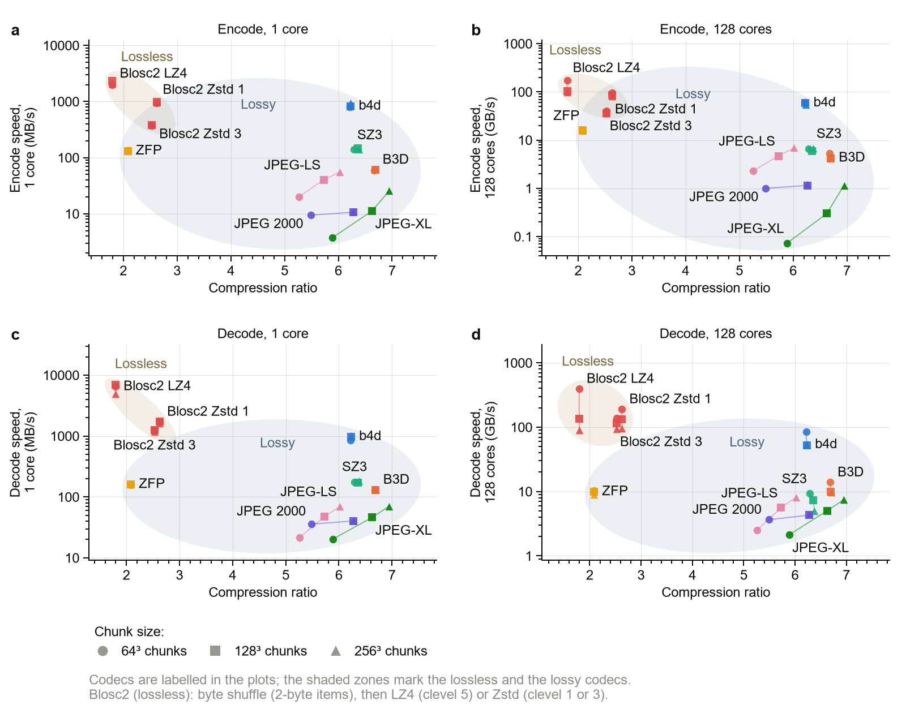
</picture>

**Figure 1.** Encoding (a, b) and decoding (c, d) speed against compression ratio on 1 core (a, c) and 128 cores (b, d),
codec time only. Markers: chunk size. Shaded: lossless and lossy codecs.

**Write rates.** The b4d writer compresses blocks of frames into shards as they arrive from the camera. To measure
its capacity independently of any camera, each camera was simulated (its frame size, bit depth and noise model) and
the frame rate was raised until frames were dropped. The sustained rate is the highest frame rate written for at least
30 s with zero dropped frames (compression and shard assembly, in-memory sink). Table 2 compares it with the maximum
full-frame rate of the real camera (IMX411 and IMX811: Sony datasheets, 12-bit readout, written as 16-bit pixels [21, 22]).

**Table 2.** Maximum rate of the real cameras and sustained write rate of the simulated cameras (zero dropped frames).

| Camera | Frame (pixels) | Bit depth | Hardware | Frame rate (fps) | Write rate (GB/s) | Pixel rate (Gpixel/s) | Frame rate, multiscale (fps) | Write rate, multiscale (GB/s) | Rate lost to multiscale (%) |
|---|---|---|---|---|---|---|---|---|---|
| Sony IMX411 | 10,640 × 14,192 | 16 | Real camera, maximum (12-bit readout) | 6.3 | 1.9 | 1.0 | – | – | – |
|  |  |  | AMD EPYC CPU, 128 cores | 264 | 79.7 | 39.9 | 203 | 61.2 | 23.3 |
|  |  |  | GPU (A6000) | 73.3 | 22.1 | 11.1 | 70.8 | 21.4 | 3.4 |
|  |  |  | 2 GPUs (A6000) | 139 | 41.9 | 20.9 | 134 | 40.4 | 3.4 |
| Sony IMX811 | 12,800 × 19,200 | 16 | Real camera, maximum (12-bit readout) | 12.4 | 6.1 | 3.0 | – | – | – |
|  |  |  | AMD EPYC CPU, 128 cores | 169 | 83.2 | 41.6 | 131 | 64.5 | 22.5 |
|  |  |  | GPU (A6000) | 44.0 | 21.6 | 10.8 | 42.5 | 20.9 | 3.4 |
|  |  |  | 2 GPUs (A6000) | 83.6 | 41.1 | 20.5 | 88.9 | 43.7 | −6.3 |
| GSPRINT4521 | 4,096 × 5,120 | 8 | Real camera, maximum | 1,000 | 21.0 | 21.0 | – | – | – |
|  |  |  | AMD EPYC CPU, 128 cores | 2,032 | 42.6 | 42.6 | 1,572 | 33.0 | 22.6 |
|  |  |  | GPU (A6000) | 678 | 14.2 | 14.2 | 655 | 13.7 | 3.4 |
|  |  |  | 2 GPUs (A6000) | 1,369 | 28.7 | 28.7 | 1,323 | 27.7 | 3.4 |
| Teledyne Kinetix | 3,200 × 3,200 | 8 | Real camera, maximum | 500 | 5.1 | 5.1 | – | – | – |
|  |  |  | AMD EPYC CPU, 128 cores | 3,827 | 39.2 | 39.2 | 3,078 | 31.5 | 19.6 |
|  |  |  | GPU (A6000) | 1,318 | 13.5 | 13.5 | 1,273 | 13.0 | 3.4 |
|  |  |  | 2 GPUs (A6000) | 2,448 | 25.1 | 25.1 | 2,365 | 24.2 | 3.4 |

<sub>Highest offered frame rate written with zero dropped frames in × 1.10 steps (the bars of Fig. 2, c and g). Multiscale: levels halved in x, y and z down to about 256 pixels, each compressed with b4d; with the GPU, level 0 is encoded on the GPU and the other levels on the CPU. A loss of 3.4 % is one step; a negative loss (Sony IMX811, 2 GPUs) is within one step.</sub>

The write rate is limited by the number of pixels per second, not of bytes: per CPU core and per GPU streaming
multiprocessor, 8-bit and 16-bit frames are encoded at similar pixel rates (0.33–0.39 Gpixel/s per core at 4 cores), so
the 16-bit sensors are written at about twice the byte rate (Fig. 2, a, b).

- *CPU.* On one AMD EPYC 9754 (128 cores) the write rate scales with 97–107 % efficiency up to 64 cores and with 76–87 %
  efficiency at 128 cores (Fig. 2, a), relative to 32 times the 4-core rate (each run held to N physical cores). At 128
  cores one CPU sustains 39–43 Gpixel/s (Table 2), 42 times the maximum rate of the IMX411, 14 times that of the IMX811,
  7.7 times that of the Teledyne Kinetix and 2.0 times that of the GSPRINT4521 (Fig. 2, c).
- *GPU.* On one NVIDIA RTX A6000 (PCIe Gen4 x16) the write rate increases approximately linearly with the number of
  streaming multiprocessors up to 48 of 84 (Fig. 2, b). For 16-bit frames it levels off at 19–20 GB/s from 64 SMs on (21.6–22.1 GB/s in the ladders of Table 2),
  near the host-to-device bandwidth of PCIe Gen4 x16 (31.5 GB/s per direction, theoretical):
  the GPU encoder is limited by the transfer of the raw frames to the device, not by its arithmetic. 8-bit frames reach
  13.5–14.2 GB/s in the ladders (Table 2). PCIe Gen5 x16 doubles the link bandwidth (63 GB/s per direction), so a single Gen5 GPU could sustain a
  higher 16-bit write rate; this was not tested. A second GPU raises the write
  rate by a factor of 1.86–2.02. One GPU sustains 12 times the maximum rate of the IMX411, 3.5 times that of the
  IMX811 and 2.6 times that of the Teledyne Kinetix; the GSPRINT4521 (21 Gpixel/s) requires two GPUs (1.37 times its
  maximum rate; Fig. 2, c).
- *Copying frames.* The writer accepts frames in place: a frame grabber can write by DMA directly into the writer's
  block buffers (buffer sharing, zero copy on the CPU), and the GPU encoder uploads from these registered buffers without
  an intermediate host copy (zero copy on the GPU). Copying each frame into the writer instead reduced the sustained rate
  by 40–46 % on the CPU (with the copy, the writer sustains 21–23 GB/s of 8-bit and 47–49 GB/s of 16-bit frames, the
  same as with a 35 % slower build: the copy, not the compression, sets the rate), by 3.2 % on one GPU and by 12–27 % on two GPUs (Fig. 2, d), where the host copies twice the bytes per
  second; the 2-GPU copy run split each frame by rows across the GPUs, whereas the 2-GPU zero-copy run used the default
  settings, so the 2-GPU loss also includes the difference between the two configurations. Blocks already in GPU memory, such as frames delivered by GPUDirect
  RDMA, are encoded without an upload; this path was not measured here.
- *Multiscale.* Writing the pyramid with level 0 costs 20–23 % of the rate on 128 CPU cores (Table 2, Fig. 2, h) and at most one ladder step (3.4 %) with one or two GPUs (Fig. 2, g, h). On the CPU the
  levels compete with level 0 for the same cores; with a GPU they are coded on host cores that are otherwise idle.

<picture>
  <source media="(prefers-color-scheme: dark)" srcset="docs/how_it_works/figs/dark/fig00b_write_rates.png">
  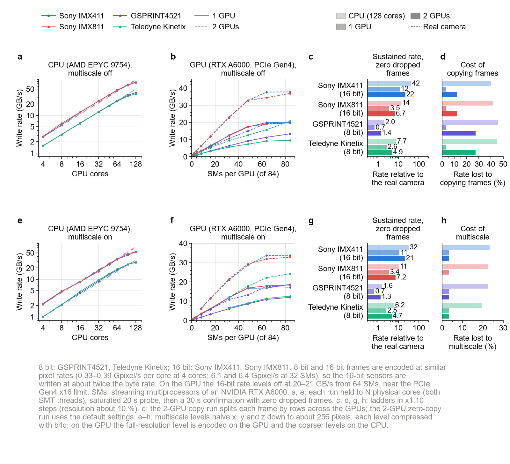
</picture>

**Figure 2.** Sustained write rate of the b4d writer. a: Against CPU cores, each run held to N physical cores (dotted:
linear scaling of the 4-core rate). b: Against the streaming multiprocessors per GPU (solid: one GPU; dashed: two GPUs). c: Sustained rate of the simulated camera relative to the
maximum rate of the real camera, for one CPU (128 cores), one GPU and two GPUs. d: Rate lost when frames are copied
into the writer instead of being written in place, CPU (128 cores), one GPU and two GPUs. e–h: As a–d with multiscale
on (levels halved in x, y and z down to about 256 pixels, each level compressed with b4d); f: the Teledyne Kinetix on
one and two GPUs is from ladders at 32, 48, 64 and 84 SMs (its saturated sweep probe underestimates the rate; run in
2026-11-18/19 with 12 DIMMs, within one ladder step of g); h: the rate lost to
multiscale relative to c. Sweeps (a, b, e, f): a probed rate confirmed for 30 s with zero dropped frames (CPU: 20 s
saturated probe, confirmation at 95 %, stepped down to 88 % and 80 % until it holds). Ladders (c, d, g, h): × 1.10 steps,
so differences below about 10 % are within one step; on the GPU every multiscale cost is within one step, on the CPU it
is 20–23 % (128 cores).

---

## How it works

This section describes the default configuration. All raw pixel values are given in ADU (analog-to-digital units), the
integer reported by the camera. σ denotes the noise standard deviation of a pixel at its signal level; values in the
variance-stabilized domain are given in units of σ. The notation is summarized in [Notation](#notation) and all parameters are listed in
[Parameters](#parameters).

### 1. Noise model and variance stabilization

#### 1.1 Concepts

**Camera model.** A pixel converts N detected photoelectrons into a raw value

x = o + g · N + ε,

where o is the offset (ADU), g the conversion gain (ADU per electron) and ε the read noise (ADU) [5, 6].

- *Photon shot noise.* Photon detection is a Poisson process: for a mean of μ photoelectrons, N has variance μ.
- *Read noise.* ε comprises the noise of the readout chain: reset noise, thermal and 1/f noise of the in-pixel source
  follower and the column amplifier, and the quantization of the analog-to-digital converter [5]. It is independent of
  the signal and is well described by a zero-mean Gaussian distribution with standard deviation g · σ<sub>r</sub> (σ<sub>r</sub> in
  electrons). In CMOS and sCMOS sensors σ<sub>r</sub> and o vary from pixel to pixel [7], and a small fraction of pixels show
  non-Gaussian random telegraph noise. Dark-current shot noise is also Poissonian; at exposure times of milliseconds it
  is small compared with the read noise and is included in σ<sub>r</sub>.

The variance of the raw value at mean signal S = g · μ above the offset is therefore that of a Poisson–Gaussian process
[2]:

σ²(S) = g · S + g² · σ<sub>r</sub>²   (ADU²).

The noise standard deviation increases with the square root of the signal. An error tolerance specified in ADU is
therefore smaller than the noise for bright pixels and larger than the noise for dim pixels; a tolerance specified in
units of σ is uniform across signal levels.

**Variance stabilization.** A variance-stabilizing transform T(x) maps the raw value x to a value whose noise standard deviation is
approximately 1 at every signal level. For Poisson data the Anscombe transform 2√(N + 3/8) has this property [3]; for
Poisson data with additive Gaussian noise the generalized Anscombe transform [4] is

T(x) = 2 √(e + σ<sub>r</sub>² + 3/8),   e = (x − o) / g,

with e the signal in electrons. One unit of T(x) then corresponds to one σ of the raw value.

**Quantization.** b4d rounds each prediction residual to an integer multiple of the step q, in units of T(x). Uniform
rounding with step q bounds the error of every pixel by q/2 and, when the residuals are not concentrated on the
quantization grid, adds a variance of q²/12 [12]. At q = 1σ the added variance is 1/12 ≈ 8.3 % of the noise variance
(4.1 % of the noise standard deviation), and the error of every pixel is at most 0.5σ.

**Fitted transform.** The generalized Anscombe transform is least accurate at low signal, where read noise dominates and
the raw values are integers: there, rounding in units of T(x) adds 10 % of the noise variance instead of 8.3 %. b4d
therefore fits the transform numerically to the camera model, so that the added variance equals q²/12 at every signal
level. The fitted curve is described by 48 knots stored in each chunk header and expanded into a lookup table with one
entry per raw value (0–65,535 ADU) at a resolution of 1/256 σ. The forward transform is one table read per pixel; the
decoder applies the inverse table. Above the read-noise-dominated range the fitted transform and the generalized
Anscombe transform agree.

#### 1.2 Example: experimental measurements from a Sony IMX411 sensor

The camera model was measured on the Sony IMX411 sensor of an exaSPIM light-sheet microscope [17] from two dark stacks
of 10,240 frames and 11 flat-field stacks of 1,024 frames each, recorded at 11 LED intensities. The photon transfer
curve [5] (Fig. 3, left) plots the temporal variance of each pixel against its mean signal; grey points are single
pixels, circles the median over the sensor.

- In the dark stacks the variance is 13.2 ADU² (σ = 3.6 ADU), the read noise of the camera (dashed line).
- Under illumination the variance increases by 1.37 ADU² per ADU of signal, which equals the conversion gain,
  g = 1.37 ADU/e⁻. σ is 21 ADU at 300 ADU above the offset and 100 ADU at 7,500 ADU.
- The camera model used by b4d (blue line) is g = 1.373 ADU/e⁻, o = 34.09 ADU, σ<sub>r</sub> = 2.65 e⁻, i.e.
  σ² = 1.373 · S + (1.373 · 2.65)². All sensor medians lie within 1.8 % of the model.

Fig. 3 (middle) compares the fitted transform with the generalized Anscombe transform, both referenced to their value at
the offset; the circles mark the median raw value of each recording, with error bars of ±1σ in ADU, which the fitted
transform maps to ±1σ in T(x) at every signal level. Fig. 3 (right) shows the variance added by quantization at q = 1σ, as
predicted (lines) and as measured on rows 0–511 of the sensor, 128 frames per recording (symbols). In the dark stacks
the generalized Anscombe transform added 10.5 % and the fitted transform 8.4 % of the noise variance; in the flat-field
stacks both added 8.0–8.5 %, against the q²/12 = 8.3 % target.

<picture>
  <source media="(prefers-color-scheme: dark)" srcset="docs/how_it_works/figs/dark/fig01_noise_units.png">
  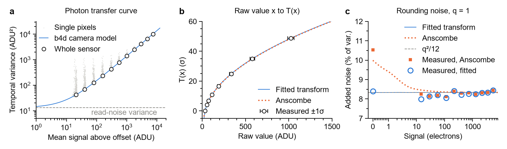
</picture>

**Figure 3.** Left: photon transfer curve of the IMX411 sensor. Middle: raw value x to T(x), fitted and generalized Anscombe
transform. Right: variance added by quantization at q = 1σ, predicted and measured.

**Invariance of the per-pixel calibration.** The per-pixel calibration of offset, read noise and gain [7]
(`tools/calibrate_camera.py`) was computed twice on the full sensor: from the raw dark and
flat-field stacks, and from the same frames after compression with the fitted transform at q = 1σ. The quantization
variance q²/12 is known exactly and was subtracted from the variances of the compressed data before the fit. The
remaining differences quantify any further change introduced by the codec (Fig. 4):

- Read noise: median 2.645 e⁻ (raw), 2.648 e⁻ (compressed), +0.1 %.
- Offset: median 33.986 ADU (raw), 33.994 ADU (compressed), +0.008 ADU.
- Gain (here in e⁻/ADU, i.e. 1/g): median 0.7291 (raw), 0.7283 (compressed), −0.04 % per pixel. The distribution of
  the compressed data is wider, because the quantization noise increases the variance of each per-pixel fit.

**Table 3.** Camera calibration from raw and compressed data (b4d, q = 1σ, fitted transform), full IMX411 sensor.

| Quantity | Raw | b4d (q = 1σ) | b4d − raw | b4d − raw (%) |
|---|---|---|---|---|
| Conversion gain, photon transfer fit (ADU/e⁻) | 1.3610 | 1.3610 | +0.0000 | +0.001 |
| Read noise (e⁻), median | 2.645 | 2.647 | +0.003 | +0.07 |
| Read noise (e⁻), 5th–95th percentile | 2.536–3.885 | 2.537–3.888 | | |
| Read noise (e⁻), 99.9th percentile | 16.730 | 16.609 | −0.121 | |
| Offset (ADU), median | 33.986 | 33.994 | +0.008 | +0.02 |
| Offset (ADU), 5th–95th percentile | 33.343–34.755 | 33.351–34.763 | | |
| Offset (ADU), 99.9th percentile | 40.040 | 40.052 | +0.012 | |
| Gain (e⁻/ADU), median | 0.7291 | 0.7283 | −0.0007 | −0.04 |
| Gain (e⁻/ADU), 5th–95th percentile | 0.7170–0.7361 | 0.7159–0.7372 | | |
| Gain (e⁻/ADU), 99.9th percentile | 0.7390 | 0.7417 | +0.0028 | |

<sub>Conversion gain: slope of the photon transfer curve over the 11 flat-field recordings. Per-pixel quantities: `calibrate_camera.py` on all 151 Mpixel; percentiles over the sensor; b4d − raw (%) of the medians: median of the relative per-pixel differences, in 16 × 16-pixel means. Data (histograms and summary statistics): `docs/how_it_works/sensor_beta3.npz`.</sub>

<picture>
  <source media="(prefers-color-scheme: dark)" srcset="docs/how_it_works/figs/dark/fig01b_sensor_histograms.png">
  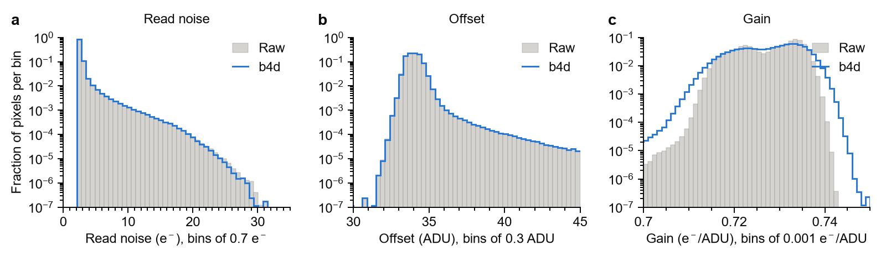
</picture>

**Figure 4.** Distributions of the per-pixel read noise, offset and gain computed from raw (grey) and compressed (blue)
data.

---

### 2. Data layout and example chunk

A b4d dataset is a zarr v3 array [14] stored as a grid of shards; each shard is one file containing a grid of chunks,
and each chunk is a 64 × 64 × 64 voxel cube (Fig. 5, left). Each chunk is compressed independently, so that any region
of a dataset can be read by decoding only the chunks it intersects (Section 4).

The example chunk is 64 × 64 × 64 voxels of a public exaSPIM recording (dataset `859684_2026-10-06_16-58-46`, channel
488 nm, tile 13, origin z = 8,120, y = 5,301, x = 10,179) acquired with the camera of Section 1.2. It contains labelled
neurites crossing a background of lower intensity in every z plane. `docs/how_it_works/fetch_example_chunk.py`
retrieves it.

The encoder concatenates the 64 z planes of a chunk along y and processes them as one array of 4,096 rows × 64 pixels
(Fig. 5, middle): z plane 0 occupies rows 0–63, z plane 32 rows 2,048–2,111 and z plane 63 rows 4,032–4,095. All
subsequent operations proceed row by row through this array; the row preceding the first row of a z plane is the last
row of the previous z plane, and only row 0 of the chunk has no preceding row.

The following sections trace a 5 × 5 pixel patch (rows 2,078–2,082, i.e. y = 30–34 of z plane 32, at the edge of a
neurite) and one pixel within it: raw value 236 ADU, T(x) = 29.05σ. Each pixel is processed in four steps:

1. The raw value x is transformed to T(x) (Section 1.1).
2. The prediction p is the mean of the three reconstructed pixels in the preceding row (upper-left, upper,
   upper-right): (29.34 + 26.36 + 24.33) / 3 = 26.68 (Section 3.1).
3. The residual T(x) − p = 2.38σ is quantized to an integer number of steps, r = +2 (Section 3.2). Only r is stored.
4. The reconstructed value is T̂ = p + r · q = 28.68, within q/2 of T(x). The decoder obtains the same value, and T̂ enters
   the predictions of the following row.

Values are shown with two decimals. The codec computes in fixed point with a resolution of 1/256 σ; differences formed
from the rounded values can therefore deviate in the last digit (29.05 − 26.68 = 2.37 from the rounded values; the
fixed-point difference is 2.38).

<picture>
  <source media="(prefers-color-scheme: dark)" srcset="docs/how_it_works/figs/dark/fig02_example.png">
  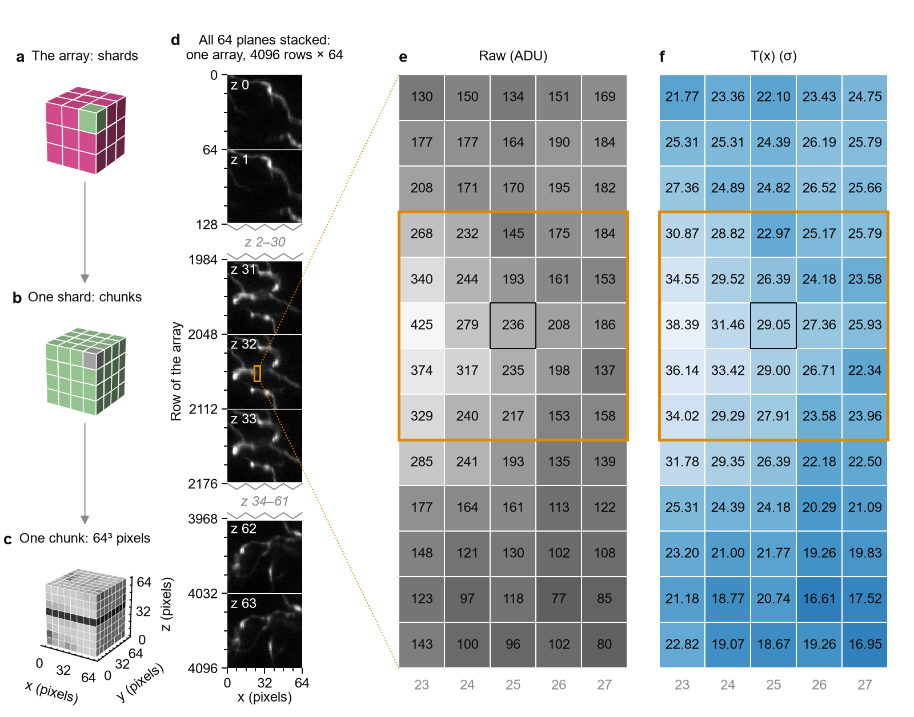
</picture>

**Figure 5.** Left: array, shard and chunk. Middle: the 64 z planes of the chunk concatenated into one array of 4,096
rows. Right: rows 2,071–2,090, x = 23–27, as raw values (ADU) and as T(x) (σ); the traced 5 × 5 patch and pixel are
outlined.

---

### 3. Encoding

#### 3.1 Prediction

Adjacent pixels are correlated, so each pixel is predicted from its neighbours (differential pulse-code modulation
[18]). The default predictor uses the mean of the three pixels in the preceding row: upper-left, upper and upper-right.
Because the prediction depends only on the preceding row, a whole row is predicted in one vectorized operation. The
predictor operates on reconstructed values T̂, not on the original values T(x), which the decoder does not have. The
encoder maintains the same reconstructed copy as the decoder, so both compute identical predictions (closed loop
[18]), and quantization errors do not accumulate along the array: in the example chunk the maximum error of T̂ is
0.50σ (RMS 0.29σ). If the encoder predicted from the original values (open loop), the decoder's predictions would
diverge from the encoder's and the error would reach 5.88σ (RMS 1.77σ).

Fig. 6 shows the predictions of the patch in decoding order. For row 2, pixel 2: (30.74 + 28.75 + 22.53) / 3 = 27.34; for
the traced pixel: (29.34 + 26.36 + 24.33) / 3 = 26.68. Pixels in the first or last column use the mean of the two
available pixels in the preceding row; row 0 of a chunk uses the pixel to its left.

<picture>
  <source media="(prefers-color-scheme: dark)" srcset="docs/how_it_works/figs/dark/fig03_predict.png">
  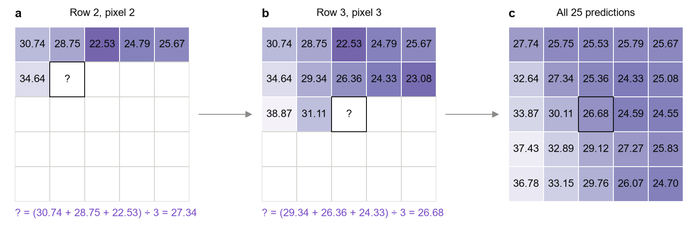
</picture>

**Figure 6.** Prediction of the patch from reconstructed pixels. Bold: the pixels averaged for each prediction.

#### 3.2 Quantization

The residual of the traced pixel is T(x) − p = 2.38σ. It is stored as the nearest integer multiple of q (q = 1σ): r = +2.
Every T(x) within ±0.5σ of p + 2 yields the same r. Fig. 7 shows the residuals of all 25 pixels of the patch (positive
green, negative pink).

<picture>
  <source media="(prefers-color-scheme: dark)" srcset="docs/how_it_works/figs/dark/fig05_quantise.png">
  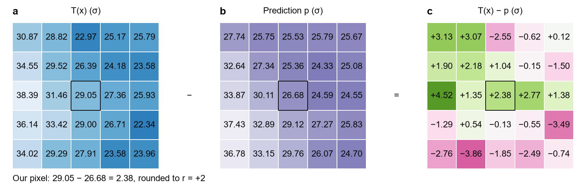
</picture>

**Figure 7.** Prediction residuals T(x) − p of the patch, in units of σ.

The decoder reconstructs T̂ = p + r · q = 26.68 + 2 = 28.68, which differs from T(x) by 0.37σ. Because r is the nearest
multiple of q, |T̂ − T(x)| ≤ q/2 = 0.5σ for every pixel. This bound is the error guarantee of the codec. At q = 1σ the
quantization error is smaller than the noise already present in each frame (±1σ), and it adds 8.3 % to the noise variance
(Section 1.1).

#### 3.3 Sign folding

The entropy coder operates on non-negative integers. The signed residual r is mapped to u = 2r for r ≥ 0 and
u = −2r − 1 for r < 0, so that 0, −1, +1, −2, +2, … map to 0, 1, 2, 3, 4, … [8] (Fig. 8). Residuals of small magnitude
remain small, and the mapping is invertible: the least significant bit of u encodes the sign. For the traced pixel,
r = +2 and u = 4.

<picture>
  <source media="(prefers-color-scheme: dark)" srcset="docs/how_it_works/figs/dark/fig06_fold.png">
  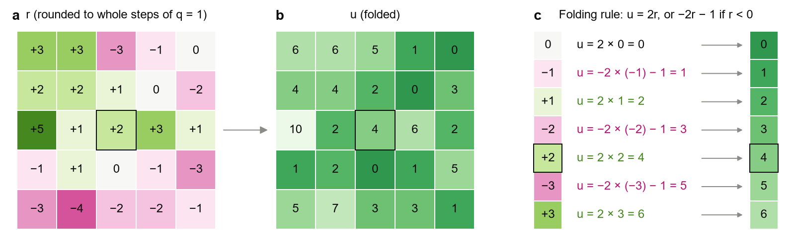
</picture>

**Figure 8.** Folding of the signed residuals r into non-negative integers u.

#### 3.4 Rice coding

A raw pixel occupies 16 bits. After prediction and quantization the distribution of u is concentrated near zero and
approximately geometric, for which Golomb codes are optimal [9]. b4d encodes u with a Rice code, the Golomb code with a
power-of-two parameter 2^k [8] (Fig. 9, left):

1. u is divided by 2^k. For the traced pixel, u = 4 (binary `100`) and k = 2: the quotient is 1 and the remainder, the
   k least significant bits, is `00`.
2. The quotient is written in unary as that number of 1 bits, followed by a terminating 0 bit.
3. The remainder is written in k bits.

u = 4 is thus encoded as `1` `0` `00` = `1000`, 4 bits instead of 16. The codes are concatenated without separators; the
terminating 0 bit delimits the variable-length unary part, after which exactly k remainder bits follow, so the decoder
can determine the boundary of every code. Fig. 9 (middle) lists the codes for k = 2; Fig. 9 (right) shows the code of
each pixel of the patch.

<picture>
  <source media="(prefers-color-scheme: dark)" srcset="docs/how_it_works/figs/dark/fig07_rice.png">
  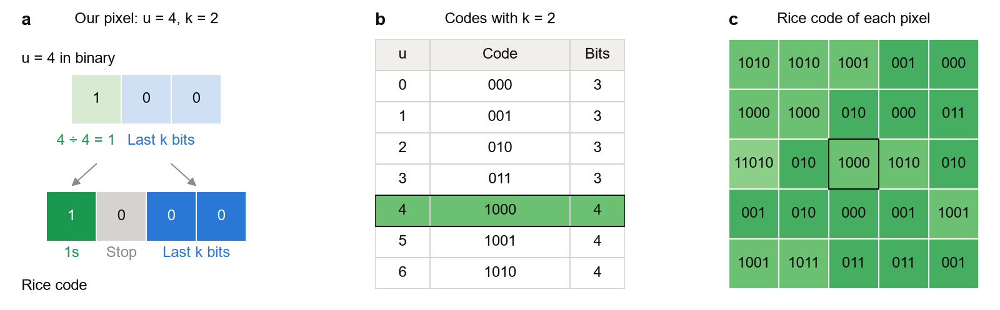
</picture>

**Figure 9.** Rice coding. Left: the code of the traced pixel. Middle: codes for k = 2. Right: codes of the patch.

The optimal k depends on the local magnitude of u. As in the adaptive Rice coder of the CCSDS lossless standard [10], b4d
selects k per group of values, here 128 values (two rows of the 64-pixel-wide array): an initial k is estimated from
the mean of u in the group, and k − 1, k and k + 1 are evaluated, retaining the shortest. For the group of the traced
pixel the cost is 618 bits at k = 0, 472 bits at k = 1 and 468 bits at k = 2. The selected k is stored in a 4-bit group
header. Two additional group types encode groups with few non-zero values: an all-zero group consists of the 4-bit
header only; a sparse group lists only the non-zero values, each as its 7-bit position in the group (0–127) followed by
its value, and is selected when it is shorter than the Rice-coded group.

The patch spans three groups, all with k = 2 (rows 1–2 in group g15, rows 3–4 in g16, which contains the traced pixel, and
row 5 in g17). Its 25 pixels are encoded in 87 bits instead of 400 (3.5 bits per pixel). The first 16 bytes of the code of
group g16 are `21 05 6b d7 ae 12 4e 73 79 cb 6e b1 8d 28 a4 49`.

#### 3.5 Groups and streams

The code length of a group depends on the magnitude of the values it encodes (Fig. 10, top). Groups in the background of
z plane 32 (g27–g31) have a mean u of 1.7–2.4, select k = 1, and occupy 339–380 bits. Groups that intersect the neurites
have a mean u of up to 5.1, because both the prediction error at intensity edges and the shot noise of bright pixels are
larger; most select k = 2 and occupy up to 505 bits. Group g16 (group 1,040 of the chunk) occupies 468 bits.

The groups are distributed cyclically over eight independent bit streams: groups 0, 8, 16, … to stream 0, groups 1, 9,
17, … to stream 1, and so on (Fig. 10, bottom left). The decoder reads the eight streams concurrently, which increases
decoding throughput. Because each stream receives every eighth group, the streams have similar lengths
(1,748 bytes for z plane 32). The streams extend over the whole chunk; the 32 groups of z plane 32 are
groups 1,024–1,055 of the 2,048 groups of the chunk.

Across the chunk at q = 1σ, 1,506 groups select k = 1, 310 select k = 0, 230 select k = 2 and 2 select k = 3 (Fig. 10,
bottom right). Larger q produces smaller u: at q = 2σ 1,839 groups select k = 0, at q = 3σ 2,014 groups, and at q = 4σ
187 groups are encoded as sparse groups.

<picture>
  <source media="(prefers-color-scheme: dark)" srcset="docs/how_it_works/figs/dark/fig08_streams.png">
  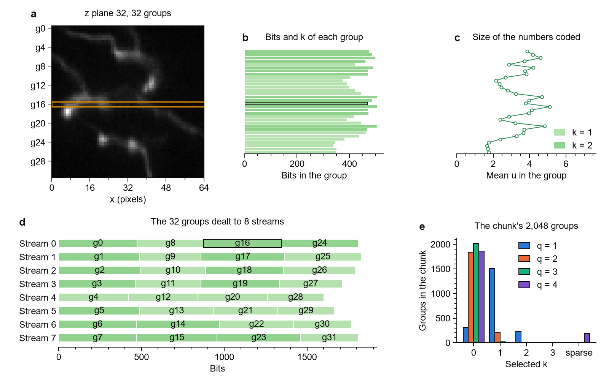
</picture>

**Figure 10.** Top: the 32 groups of z plane 32, their code length, k and mean u. Bottom left: distribution of the groups
over eight streams. Bottom right: histogram of k over the 2,048 groups of the chunk at q = 1, 2, 3 and 4σ.

---

### 4. Container format

The raw chunk occupies 16 bits per pixel (524,288 bytes). The compressed chunk consists of headers followed by the eight
streams of Section 3.5 and occupies 99,931 bytes, 3.05 bits per pixel: a compression ratio of 5.25
(Fig. 11, top).

| | Size (bytes) | Note |
|---|---|---|
| Raw chunk | 524,288 | 64 × 64 × 64 voxels × 2 bytes |
| Compressed chunk (q = 1σ) | 99,931 | compression ratio 5.25 |
| Headers | 339 | 0.34 % of the compressed chunk |

<picture>
  <source media="(prefers-color-scheme: dark)" srcset="docs/how_it_works/figs/dark/fig09_file.png">
  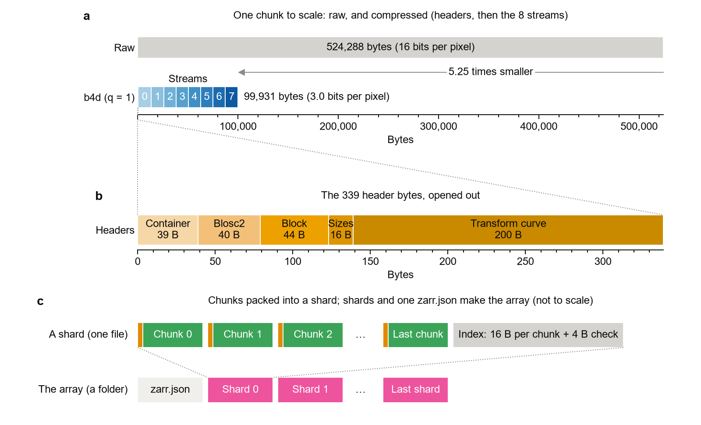
</picture>

**Figure 11.** Top: raw and compressed chunk to scale. Middle: composition of the headers. Bottom: chunks, shards and
the array.

The headers contain all parameters required for decoding, so each chunk is self-contained:

| Part | Bytes | Content (values of the example) |
|---|---|---|
| Container | 39 | b4d marker and container version, number of dimensions and shape, number and size of pieces |
| Blosc2 [16] | 40 | Blosc2 chunk header (sizes, flags), block offset and length |
| Block | 44 | Format version, mode (1), bytes per pixel (2), q (1); camera model: g = 1.373 ADU/e⁻, o = 34.09 ADU, σ<sub>r</sub> = 2.65 e⁻; row width (64), number of pixels (262,144) and of groups (2,048); lengths of streams 0–2; flags: predictor, entropy coder |
| Stream lengths | 16 | Lengths of streams 3–6 (stream 7 occupies the remainder) |
| Transform | 200 | The 48 knots of the fitted transform (Section 1.1) |

**Chunks, shards and arrays.** b4d writes zarr v3 arrays with the sharding codec [14]. A shard is one file that
contains its chunks consecutively, followed by an index of 16 bytes per chunk (offset and length) and a 4-byte CRC32C
checksum; a reader can therefore retrieve any single chunk without reading the remainder of the shard. The array is a
directory that contains one `zarr.json` metadata file (shape, chunk and shard shape, codec configuration) and the shard
files. The number of chunks per shard is set when the array is created. Multiscale pyramids are written as OME-NGFF
0.5 groups [15].

---

### 5. Decoding and reconstruction error

The decoder inverts each stage (Fig. 12):

1. **Unfolding.** u is read from the Rice code (`1000` → u = 4) and mapped back to r: r = u / 2 for even u and
   r = −(u + 1) / 2 for odd u. For the traced pixel r = +2.
2. **Reconstruction.** The decoder forms the same prediction as the encoder from the reconstructed preceding row
   (Section 3.1) and computes T̂ = p + r · q = 26.68 + 2 × 1 = 28.68σ. The reconstructed row is the input to the
   predictions of the following row.
3. **Inverse transform.** T̂ is mapped back to ADU with the inverse table and rounded to an integer: 230 ADU. The error
   is 230 − 236 = −6 ADU, or −0.35σ (σ ≈ 17 ADU at this signal level).

<picture>
  <source media="(prefers-color-scheme: dark)" srcset="docs/how_it_works/figs/dark/fig10_decode.png">
  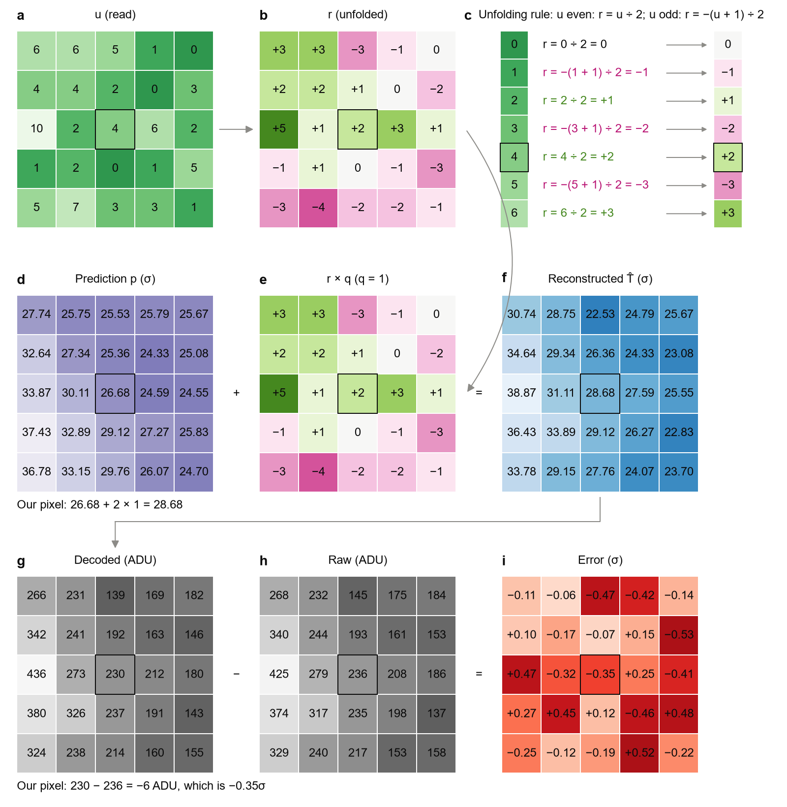
</picture>

**Figure 12.** Decoding of the patch. Top: unfolding of u to r. Middle: reconstruction T̂ = p + r · q. Bottom: decoded
values and their error (scale from 0 to 0.5σ, the q/2 bound).

Over the full example chunk at q = 1σ:

| Quantity | Value |
|---|---|
| Maximum error of T̂ (σ) | 0.50 (the q/2 bound) |
| Maximum error after rounding to integer ADU (σ) | 0.58 |
| Root-mean-square error (ADU) | 3.1 |
| Mean error, bias (ADU) | −0.006 |

The error in ADU scales with the noise: it is several ADU for bright pixels and approximately 1 ADU for pixels near the
offset.

---

### 6. Rate–distortion: the quantization step q

q determines the trade-off between compressed size and reconstruction error. A larger q yields coarser quantization,
smaller u and a shorter code; the maximum error of T̂ increases in proportion, to q/2. Fig. 13 shows the patch decoded at
q = 1, 2 and 3σ and its error on a common scale (0 to 1.5σ).

<picture>
  <source media="(prefers-color-scheme: dark)" srcset="docs/how_it_works/figs/dark/fig11_q.png">
  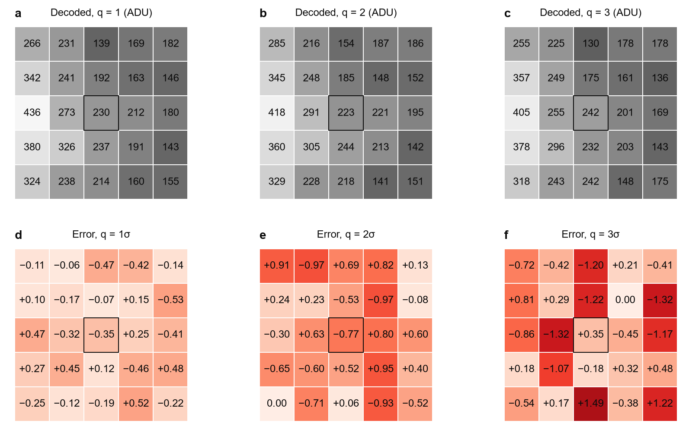
</picture>

**Figure 13.** The patch decoded at q = 1, 2 and 3σ (top) and the reconstruction error (bottom).

| q (σ) | Compressed chunk (bytes) | Compression ratio | Maximum error (σ) | RMS error (ADU) |
|---|---|---|---|---|
| 1 | 99,931 | 5.25 | 0.58 | 3.1 |
| 2 | 69,593 | 7.53 | 1.19 | 6.2 |
| 3 | 55,682 | 9.42 | 1.65 | 9.2 |
| 4 | 47,412 | 11.06 | 2.27 | 12.0 |

---

## Notation

| Symbol | Meaning |
|---|---|
| ADU | Analog-to-digital unit, the integer value reported by the camera |
| e⁻ | Photoelectron |
| o | Offset (ADU) |
| g | Conversion gain (ADU/e⁻); x = o + g · N + ε |
| σ<sub>r</sub> | Read noise (e⁻) |
| σ | Noise standard deviation of a pixel at its signal level; T(x) is expressed in units of σ |
| T(x) | Variance-stabilized value of the raw pixel value x |
| T̂ | Reconstructed value of T(x), \|T̂ − T(x)\| ≤ q/2 |
| q | Quantization step (σ) |
| p | Prediction of T(x) from reconstructed neighbouring pixels |
| r | Quantized residual, round((T(x) − p) / q); the only value stored per pixel |
| u | Folded residual, u ≥ 0 |
| k | Rice parameter, selected per group of 128 values |
| Closed loop (mode 1) | Prediction from reconstructed values T̂ |
| Stream | One of eight independently decodable bit streams of a chunk |
| Chunk | The unit of compression (here 64 × 64 × 64 voxels); shard: a file containing multiple chunks |

---

## Install

b4d needs Python ≥ 3.10, numpy, a C compiler and the C-Blosc2 library. The build is portable: it uses no `-march` or
`-mcpu` flag (gcc and clang: `-mtune=native`; MSVC and clang-cl: `/arch:AVX2`), so a wheel built on one x86-64 machine
runs on any other with AVX2. `B4D_CFLAGS="-march=native"` makes a machine-specific build; it was not faster for b4d on
the reference machine.

Optional extras: `[zarr]` (numcodecs, zarr ≥ 3), `[gpu]` (CuPy for CUDA 12), `[sim]` and `[tools]` (simulator and
benchmark tools), `[viewers]` (napari, napari-ome-zarr, dask), `[dev]` (tests and formatting).

### Linux

```
sudo apt install libblosc2-dev pkg-config        # or your distribution's c-blosc2 package
cd b4d
pip install ".[zarr]"
```

Or build against a C-Blosc2 source tree: `BLOSC2_DIR=/path/to/c-blosc2 pip install .` (expects
`$BLOSC2_DIR/build/blosc/libblosc2.a`, built with cmake).

### macOS (Apple Silicon or Intel)

```
brew install c-blosc2 pkg-config
cd b4d
pip install ".[zarr]"
```

### Windows

Install the "Build Tools for Visual Studio" (C++ workload) and take C-Blosc2 from conda-forge inside the Python
environment:

```
conda install -c conda-forge c-blosc2
cd b4d
pip install ".[zarr]"            # setup.py finds %CONDA_PREFIX%\Library
```

Alternatively `vcpkg install blosc2:x64-windows` with `VCPKG_ROOT` set, or `BLOSC2_DIR` pointing at a prefix with
`include\blosc2.h`, `lib\blosc2.lib` and `bin\blosc2.dll`. The extension finds `blosc2.dll` through `CONDA_PREFIX`,
`VCPKG_ROOT`, `BLOSC2_DIR` or `B4D_DLL_DIR`.

**Recommended on Windows: clang-cl.** It encodes 13–19 % faster than MSVC with identical output
(`validation/test_codec_consistency.py` pins the output hashes). `setup.py` removes MSVC's whole-program optimization
(`/GL`, `/LTCG`) for clang-cl builds; with it the module was 13–17 % slower.

```
conda install -c conda-forge clang
set B4D_CC=clang-cl
set B4D_CFLAGS=/clang:-O3 /clang:-mtune=native
pip install . --no-cache-dir
```

### GPU support

```
pip install ".[gpu]"            # CuPy for CUDA 12; the kernel is compiled with NVRTC at first use
```

An NVIDIA GPU with CUDA 12 drivers is required. Without a GPU, `backend="emu"` runs a CPU emulation of the kernel for
tests.

### Check the installation

```
pip install ".[dev]"
python -m pytest tests validation          # from the b4d/ directory
```

---

## Quick start

```python
import numpy as np, b4d

cam = b4d.Camera(conversion=1.373, offset=34.09, read_noise=2.65)   # ADU/e-, ADU, e- (Section 1.2)
blob = b4d.compress(img, camera=cam)          # uint8 or uint16, any shape; q = 1σ, mode 1, above3, Rice
out = b4d.decompress(blob)                    # same shape and dtype; |error| ≤ 0.5σ per pixel
print(img.nbytes / len(blob))                 # compression ratio
```

Write a zarr v3 array (readable by any zarr-python reader after `import b4d`):

```python
import zarr
from b4d.zarr3 import B4D
z = zarr.create_array(store="stack.zarr", shape=(512, 2048, 2048), chunks=(64, 64, 64),
                      shards=(64, 2048, 2048), dtype="uint16", serializer=B4D(camera=cam), compressors=None)
z[:] = stack
```

Record a camera (here the built-in simulator) at full rate with the native writer:

```
b4d-record --source simulated --source-arg shape=2048,2048 --source-arg fps=100 --seconds 10 --out run.zarr
```

---

## Usage

### Codec

```python
blob = b4d.compress(img, camera=cam)                          # defaults: q=1, mode=1, predictor="above3", entropy="rice"
blob = b4d.compress(img, q=0)                                 # lossless
blob = b4d.compress(img, q=2.0, mode=2, camera=cam,
                    predictor="above", entropy="ans", threads=8)
out = b4d.decompress(blob, threads=8)
b4d.save("x.b4d", img, camera=cam); img2 = b4d.load("x.b4d")
```

- Arguments after the data are keyword-only: `compress(arr, *, ...)`, `compress_tiles(arr, tile, *, ...)`,
  `decompress(buf, *, threads=1, out=None)`, `load(path, *, threads=1)`. All parameters are listed under
  [Parameters](#parameters).
- `img` is `uint8` or `uint16` of any shape; rows are the last axis (`row_width=` overrides it). Arrays larger than
  512 MiB are split into several Blosc2 chunks.
- The output content is deterministic; the byte layout of a blob can differ between `threads` values, because Blosc2
  stores blocks in completion order.
- Calls release the GIL, so concurrent `compress` calls from several threads run in parallel. Inside zarr-python, leave
  the codec at `threads=1` and let zarr parallelize across chunks (`zarr.config.set({"async.concurrency": N})`).
- `b4d.exact_vst(cam)` returns the fitted transform; `b4d.__version__` the package version.

### Per-pixel calibration

```python
cal = b4d.PixelCalibration.load("camera_cal.npz", cam)       # from tools/calibrate_camera.py
blob = b4d.compress(img, camera=cam, calibration=cal)
arr = zs.create(path, shape, shards=shards, chunks=chunks, codec=codec, calibration=cal, origin=(y0, x0))
```

Pixels at least 1.5 times noisier than the camera model are quantized with a coarser step in proportion to their own
noise, so that their error remains the same fraction of their noise; hot-pixel offsets are removed before prediction
and restored on decoding. The pixel list is stored in every chunk (format v7), so readers need nothing else. `origin` is
the position of the array's first pixel on the map (`b4d-record --calibration` sets it). Requires mode 1 with
`above3`, or mode 2 with `above`, and the CPU encoder; in a pyramid, level 0 only; not available through the zarr-python codec. A map measured in
one camera mode does not apply to another.

### zarr codecs

Zarr v3: `b4d.zarr3.B4D` is an array-to-bytes codec that replaces the default `bytes` serializer (Quick start). Zarr
v2: `b4d.B4DCodec` is a numcodecs codec:

```python
z = zarr.create_array(store="stack.zarr", shape=img.shape, chunks=(1, 1024, 1024), dtype=img.dtype,
                      compressors=[b4d.B4DCodec(camera=cam)], zarr_format=2)
```

Both register under the codec name `"b4d"`; readers only need `import b4d` before opening the store. zarr-python's
`z[:] = data` path reaches 1–2 GB/s with any codec; acquisition-rate writing uses the native writer.

### Native zarr writer

`b4d.zarr_store` writes zarr v3 sharded stores from C (`b4d_zarr.c`): one call per block of frames compresses every
chunk on a native thread pool, assembles the shard files (chunks and crc32c index) and writes them, in a single GIL
release. Design, measurements and tuning rules: [docs/WRITER_DESIGN.md](docs/WRITER_DESIGN.md).

```python
import b4d.zarr_store as zs
from b4d.zarr3 import B4D
arr = zs.create("stack.zarr", (4096, 10640, 14192), dtype="uint16",
                shards=(64, 1408, 3584), chunks=(64, 64, 64),   # both required
                codec=B4D(camera=cam), threads=128)
fut = arr[z0:z0 + 64].write(block)                     # contiguous (64, Y, X); returns a Future
fut.result()                                           # the block buffer is free again
arr.close()
```

- Blocks start on shard boundaries and cover whole shards (except at the array edge); windows in y and x are allowed.
- `sink="memory"` compresses and assembles the shards without writing (benchmarks).
- `direct_io=True` writes each shard unbuffered and write-through (Windows `FILE_FLAG_NO_BUFFERING|WRITE_THROUGH`,
  Linux `O_DIRECT`), with a fallback to buffered writes; the files are identical either way.
- Besides B4D, raw and the zarr `blosc` codec (lz4, lz4hc, zstd) are encoded on the native pool; other numcodecs codecs
  are encoded in Python threads and assembled natively.
- `zs.open({"driver": "zarr3", "kvstore": {...}, "metadata": {...}}, create=True)` creates an array from a spec.

### Multiscale pyramids

```python
arr = zs.create_multiscale("stack.zarr", shape, shards=shards, chunks=chunks, dtype="uint16", codec=B4D(camera=cam),
                           levels="auto", factors=(2, 2, 2), scale=(dz, dy, dx), units="micrometer")
```

Writes an OME-NGFF 0.5 group (`stack.zarr/0`, `/1`, ...). Each block is box-averaged in C (exact integer mean with
rounding) and every level is written by the native writer; `levels="auto"` halves until the smallest axis would drop
below 256 pixels. Writes must be whole frames. Chunk and shard depth are the same at every level (downsampled planes
accumulate across blocks; `close()` flushes the rest), and shard footprints grow up the pyramid
(`shard_policy="constant_bytes"`). Each B4D level is coded with the noise model of the averaged pixels (averaging n
pixels: conversion/n, read noise · √n), so q keeps its meaning at every level. Viewers that decode chunks in their own
code (neuroglancer, viv) do not know the b4d codec: `pyramid_codec=numcodecs.Zstd(3)` stores levels ≥ 1 in a standard
codec. Cost: Table 2 and Fig. 2, e–h.

### GPU encoder

```python
from b4d.cuda_encoder import CudaTileEncoder, MultiGpuEncoder
enc = CudaTileEncoder(cam, device=0)                        # q=1, mode=1, above3, rice by default
enc = MultiGpuEncoder(cam, devices=(0, 1), split="rows")    # split="blocks" (default): whole blocks per device
arr.encoder = enc.encode_tiles                              # arr: a b4d.zarr_store array
```

One CUDA kernel (`b4d_rice_kernel.h`, compiled at first use with NVRTC) computes the residuals and Rice streams of
64³ chunks for the predictors `above3` (mode 1), `above` (modes 1 and 2) and `mean3d`, with the `rice` or `ans` coder
(`ans` is finished on the host); `left_above`, `b3d` and `huffman` run on the CPU encoder only. Its output is byte-identical to the
C encoder, checked by `validation/` and on the first block of every recording. Measurements and hardware choice:
[docs/GPU_VS_CPU.md](docs/GPU_VS_CPU.md).

### Camera ingest

A *block source* owns a pool of `nblocks` buffers of `frames_per_block` frames that the camera's DMA engine fills;
`BlockRecorder` compresses each completed block in place (native CPU writer or CUDA encoder) and releases it. The
contract (`src/b4d/ingest/protocol.py`) is structural, so a camera package implements it without importing b4d;
`examples/minimal_block_source.py` is the smallest implementation, and the `egrabber`, `dcam`, `pvcam` and `tucam`
packages of this repository are complete ones.

```python
from b4d.ingest import BlockRecorder, RecorderConfig, SimulatedCameraSource
src = SimulatedCameraSource(shape=(2048, 2048), fps=100, frames_per_block=64, nblocks=3)
with BlockRecorder(src, RecorderConfig(path="run.zarr", q=1, gpu="none")) as rec:   # gpu="staged": CUDA encoder
    rec.start(seconds=30)
    print(rec.report(rec.run()))
```

`RecorderConfig` holds the writer settings (path, sink, threads, max_commits, chunks, shards, q, mode, predictor,
entropy, dither, multiscale, gpu, verify, ...); frame geometry, rate, block depth and the camera noise model come from
the source. `RecorderConfig.from_env()` reads `B4D_ENCODER=cpu|cuda`, `B4D_THREADS`, `B4D_MAX_COMMITS`,
`B4D_DIRECT_IO`, `B4D_GPU_SLOTS`, `B4D_GPU_BATCH_TILES`, `B4D_GPU_HOST_THREADS` and `B4D_GPU_CHECK` for host
applications.

### Command-line tools

```
b4d-record --source simulated --source-arg shape=2048,2048 --source-arg fps=100 --seconds 10 --sink memory
b4d-record --source egrabber_camera.source:EGrabberSource --source-arg serial=<serial> --seconds 60 --q 1 --out D:\data\run1
b4d-tune --camera imx811 --q 1                       # measured best writer settings for a camera (from a checkout)
python tools/stream_sim.py --shape 2048,2048 --fps 500 --seconds 10 --sink memory --zero-copy
python tools/disk_speed.py <path>                    # sustained drive write speed
```

### Viewing

- `tools/napari_visualization.py [dataset]` opens a b4d array or OME-Zarr pyramid in napari with lazy decoding
  (`pip install ".[viewers]"`). Any zarr-python based viewer only needs `import b4d.zarr3` before opening.
- `tools/neuroglancer_visualization.py <dataset> [--codec zstd] [--open]` serves the dataset to neuroglancer (and any
  zarr v3 client) as a virtual unsharded zarr v3 view, decoding b4d chunks on demand and re-encoding them as raw or
  zstd; nothing is written to disk.

---

## Parameters

Parameters of `b4d.compress`, the zarr codec `b4d.zarr3.B4D` and the writers in `b4d.zarr_store`. Defaults correspond
to the configuration described above.

**Camera model** (`b4d.Camera`)

| Parameter | Values | Default | Meaning |
|---|---|---|---|
| `conversion` | > 0 | 1.0 | Conversion gain g (ADU/e⁻) |
| `offset` | ≥ 0 | 0.0 | Offset o (ADU) |
| `read_noise` | ≥ 0 | 0.0 | Read noise σ<sub>r</sub> (e⁻) |
| `exact_vst` | `"variance"`, `"std"`, `False` | `"variance"` | Fitted transform: quantization adds q²/12 of the variance at every signal level (`"variance"`), or the transformed noise has unit standard deviation (`"std"`); `False`: generalized Anscombe transform |

**Codec**

| Parameter | Values | Default | Meaning |
|---|---|---|---|
| `q` | 0–15.75 in steps of 0.25 | 1.0 | Quantization step (σ); 0 = lossless |
| `mode` | 1, 2 | 1 | 1: closed-loop quantization of the prediction residual; 2: quantization of T before prediction [1] |
| `predictor` | `"above3"`, `"above"`, `"left_above"`, `"mean3d"`, `"b3d"` | `"above3"` | Mean of the three pixels in the preceding row; the upper pixel; mean of the left and upper pixel; 12-pixel causal mean across two planes; the original B3D codec end to end |
| `entropy` | `"rice"`, `"huffman"`, `"ans"` | `"rice"` | Adaptive Rice coding; canonical Huffman coding with zero-run symbols; range asymmetric numeral systems |
| `dither` | `False`, `True`, `"listed"` | `False` | Seeded subtractive dither [12, 13] on every pixel, or only on the pixels listed in a calibration |
| `calibration` | `b4d.PixelCalibration` or `None` | `None` | Per-pixel offset and read noise [7]; mode 1 with `"above3"`, or mode 2 with `"above"` |
| `origin` | (row, column) | (0, 0) | Position of the first pixel on the calibration map |
| `threads` | ≥ 1 | 1 | CPU threads per call |
| `blocksize`, `row_width`, `max_chunk_bytes` | Integers | Automatic | Blosc2 block size (bytes); row width used by the predictor (pixels); maximum size of one Blosc2 chunk |

**Per-pixel calibration** (`b4d.PixelCalibration(read_noise_dn, camera, *, offset, response, min_raise, skip, offset_limit, flatten)`)

| Parameter | Default | Meaning |
|---|---|---|
| `min_raise` | 1.5 | a pixel is listed when its noise at zero signal is at least this multiple of the camera model |
| `skip` | 1.25 | a listed pixel whose step reaches this multiple of q is excluded from the predictions of the following row |
| `offset_limit` | 1.0 | Offset deviations below this value (ADU) are not corrected |
| `flatten` | `False` | Encoder-side flat-field correction (decodes to the corrected image) |

**Storage** (`b4d.zarr_store.create`, `create_multiscale`)

| Parameter | Values | Default | Meaning |
|---|---|---|---|
| `shards`, `chunks` | Tuples of integers | Required | Shard and chunk shape (voxels per axis) |
| `dtype` | `"uint8"`, `"uint16"` | `"uint16"` | Pixel type |
| `codec` | `b4d.zarr3.B4D` or another zarr codec | B4D with defaults | Codec of level 0 |
| `sink` | `"disk"`, `"memory"` | `"disk"` | Write to files or to memory (benchmarks) |
| `threads`, `writers`, `max_threads` | ≥ 1 | Automatic, 1, none | Encoder threads, concurrent block writers, upper limit |
| `direct_io` | `True`, `False` | `False` | Unbuffered file writes |
| `levels` | Integer or `"auto"` | Required (multiscale) | Number of downsampled levels |
| `factors` | Per-axis integers | (2, 2, 2) | Downsampling factors per level (box mean) |
| `scale`, `axes`, `units` | | 1, (z, y, x), none | OME-NGFF voxel size, axis names and units |
| `pyramid_codec` | Zarr codec | As level 0 | Codec of levels ≥ 1 (e.g. Zstd for viewers without the b4d codec) |
| `shard_policy` | `"constant_bytes"`, `"same"` | `"constant_bytes"` | Shard shape of levels ≥ 1 |

**GPU encoder** (`b4d.cuda_encoder.CudaTileEncoder`, `MultiGpuEncoder`)

| Parameter | Values | Default | Meaning |
|---|---|---|---|
| `q`, `mode`, `predictor`, `entropy`, `dither` | As for the codec, except: predictor `above3` (mode 1 only), `above` or `mean3d`; entropy `rice` or `ans`; `dither` with `rice` | As for the codec | |
| `device` | GPU index | 0 | CUDA device |
| `devices` | Tuple of GPU indices | (0, 1) | Devices of the multi-GPU encoder |
| `split` | `"blocks"`, `"rows"` | `"blocks"` | Distribute whole blocks, or the rows of each block, over the GPUs |
| `backend` | `"cuda"`, `"emu"` | `"cuda"` | GPU, or a CPU emulation of the kernel for testing |
| `batch_tiles`, `slots`, `host_threads` | | 2048, 2, automatic | Chunks per kernel launch, blocks in flight per GPU, host threads |
| `tile_copy`, `device_blocks`, `sm_limit`, `check` | | `True`, `False`, 0, `True` | Gather tiles on the device (needed for 8-bit); blocks already in device memory; SMs used (0 = all); verify the first block against the CPU codec |

---

## Testing and benchmarks

```
python -m pytest tests validation                 # unit tests and codec consistency against frozen bitstreams
python tools/stream_sim.py --help                 # simulated camera -> writer, any sink
```

The C unit tests are in `tests/c/b4d_test.c` (`make test`). The write-rate benchmarks of Table 2 and Figure 2 and the codec comparison of Figure 1 were run with scripts kept
outside this repository; their result tables for Figures 1 and 2 are in `docs/how_it_works/data/` (see [Reproducibility](#reproducibility)).

## Repository layout

```
b4d/
  src/c/          b4d_blosc2.c/.h (codec), b4d_zarr.c (native sharded-zarr writer), b4d_original.c, b4d_example.c
  src/b4d/        Python package: _b4d.c (extension), zarr3.py and zarr_store.py (codec and writer API),
                  chunk_format.py, cuda_encoder.py and b4d_rice_kernel.h (CUDA), b3d.py (original B3D),
                  hardware.py (thread and core counts), tune.py (b4d-tune), ingest/ (BlockSource contract,
                  SimulatedCameraSource, BlockRecorder, b4d-record)
  tests/          pytest suite and tests/c/b4d_test.c (C unit tests)
  validation/     codec consistency suite against frozen reference bitstreams (golden_bitstreams.json), the original
                  B3D reference (test_b3d_reference.py, original_reference.py), compare_codecs.py
  tools/          stream_sim.py, disk_speed.py, calibrate_camera.py (+ capture_stats.py, stack_io.py),
                  compare_camera_settings.py, napari_visualization.py, neuroglancer_visualization.py (tools/README.md)
  examples/       minimal_block_source.py (camera template), record_simulated.py
  docs/           CHANGES_FROM_B3D.md, COMPARISON.md, WRITER_DESIGN.md, GPU_VS_CPU.md, MEMORY_BANDWIDTH.md,
                  how_it_works/ (figures of this README in figs/, and the scripts that make them)
  setup.py (extension build), pyproject.toml (metadata, entry points), Makefile (C library only)
```

| Document | Content |
|---|---|
| [docs/CHANGES_FROM_B3D.md](docs/CHANGES_FROM_B3D.md) | Algorithmic changes from B3D and their measured effect |
| [docs/COMPARISON.md](docs/COMPARISON.md) | `above3` against B3D and dither on calibration recordings |
| [docs/WRITER_DESIGN.md](docs/WRITER_DESIGN.md) | Design of the writer, measurements and tuning rules |
| [docs/GPU_VS_CPU.md](docs/GPU_VS_CPU.md) | CPU and GPU write rates, hardware prices and choice |
| [docs/MEMORY_BANDWIDTH.md](docs/MEMORY_BANDWIDTH.md) | Host RAM traffic of each writer path and the DIMMs it needs |
| [tools/README.md](tools/README.md) | Camera simulator, writer tuning (`b4d-tune`), per-pixel camera calibration, drive speed, viewers |
| [validation/README.md](validation/README.md) | Codec consistency suite against frozen reference bitstreams |

Other packages of the repository:

| Document | Content |
|---|---|
| [../README.md](../README.md) | Repository overview: the five packages and how they fit together |
| [../egrabber/README.md](../egrabber/README.md) | Euresys eGrabber (CoaXPress) driver with a zero-copy block interface |
| [../dcam/README.md](../dcam/README.md) | Hamamatsu DCAM-API driver with a zero-copy block interface |
| [../pvcam/README.md](../pvcam/README.md) | Teledyne Photometrics PVCAM driver with a zero-copy block interface |
| [../tucam/README.md](../tucam/README.md) | Tucsen TUCam SDK driver with a zero-copy block interface |

## Notes

- Pixels below the offset (read-noise excursions on dim data) are coded through a linear continuation of the
  transform, so the error bound holds there too.
- On dim, read-noise-dominated data the lossless ratio of b4d (`q=0`) is similar to Zstd with byte shuffle (about 3);
  the gain of b4d is in the noise-bounded modes.
- A blob is a `B4DP` header followed by Blosc2 chunks; it is not compatible with the HDF5 filter of B3D (id 32016).
- Format version: 11 (eight Rice streams per chunk and the fitted transform); blobs of earlier versions still decode
  (`tests/test_rice_golden.py`).

---

## Citing

If you use b4d, please cite it as given in [CITATION.cff](../CITATION.cff) (DOI [10.5281/zenodo.XXXXXXX](https://doi.org/10.5281/zenodo.XXXXXXX)), together with B3D: Balázs B, Deschamps J, Albert M, Ries J,
Hufnagel L. A real-time compression library for microscopy images. bioRxiv 164624 (2017).
doi:[10.1101/164624](https://doi.org/10.1101/164624).

---

## References

1. Balázs B, Deschamps J, Albert M, Ries J, Hufnagel L. A real-time compression library for microscopy images.
   bioRxiv 164624 (2017). doi:[10.1101/164624](https://doi.org/10.1101/164624).
2. Foi A, Trimeche M, Katkovnik V, Egiazarian K. Practical Poissonian-Gaussian noise modeling and fitting for
   single-image raw-data. IEEE Trans. Image Process. 17, 1737–1754 (2008). doi:[10.1109/TIP.2008.2001399](https://doi.org/10.1109/TIP.2008.2001399).
3. Anscombe FJ. The transformation of Poisson, binomial and negative-binomial data. Biometrika 35, 246–254 (1948).
   doi:[10.1093/biomet/35.3-4.246](https://doi.org/10.1093/biomet/35.3-4.246).
4. Murtagh F, Starck JL, Bijaoui A. Image restoration with noise suppression using a multiresolution support.
   Astron. Astrophys. Suppl. Ser. 112, 179–189 (1995).
   [ADS 1995A&AS..112..179M](https://ui.adsabs.harvard.edu/abs/1995A%26AS..112..179M).
5. Janesick JR. Photon Transfer: DN → λ. SPIE Press, Bellingham (2007). doi:[10.1117/3.725073](https://doi.org/10.1117/3.725073).
6. European Machine Vision Association. EMVA Standard 1288: Standard for characterization of image sensors and
   cameras, release 4.0 (2021). [emva.org](https://www.emva.org/standards-technology/emva-1288/).
7. Huang F, Hartwich TMP, Rivera-Molina FE, et al. Video-rate nanoscopy using sCMOS camera-specific single-molecule
   localization algorithms. Nat. Methods 10, 653–658 (2013). doi:[10.1038/nmeth.2488](https://doi.org/10.1038/nmeth.2488).
8. Rice RF, Plaunt JR. Adaptive variable-length coding for efficient compression of spacecraft television data.
   IEEE Trans. Commun. Technol. 19, 889–897 (1971). doi:[10.1109/TCOM.1971.1090789](https://doi.org/10.1109/TCOM.1971.1090789).
9. Golomb SW. Run-length encodings. IEEE Trans. Inf. Theory 12, 399–401 (1966). doi:[10.1109/TIT.1966.1053907](https://doi.org/10.1109/TIT.1966.1053907).
10. CCSDS. Lossless Data Compression. Recommended Standard CCSDS 121.0-B-3 (Blue Book), Consultative Committee for
    Space Data Systems (2020). [public.ccsds.org](https://public.ccsds.org/Pubs/121x0b3.pdf).
11. Weinberger MJ, Seroussi G, Sapiro G. The LOCO-I lossless image compression algorithm: principles and
    standardization into JPEG-LS. IEEE Trans. Image Process. 9, 1309–1324 (2000). doi:[10.1109/83.855427](https://doi.org/10.1109/83.855427).
12. Widrow B, Kollár I. Quantization Noise. Cambridge University Press (2008). doi:[10.1017/CBO9780511754661](https://doi.org/10.1017/CBO9780511754661).
13. Roberts LG. Picture coding using pseudo-random noise. IRE Trans. Inf. Theory 8, 145–154 (1962).
    doi:[10.1109/TIT.1962.1057702](https://doi.org/10.1109/TIT.1962.1057702).
14. Zarr Developers. Zarr storage specification, version 3, with the sharding codec (2023).
    [zarr-specs.readthedocs.io](https://zarr-specs.readthedocs.io/en/latest/v3/core/index.html).
15. Moore J, Basurto-Lozada D, Besson S, et al. OME-Zarr: a cloud-optimized bioimaging file format with international
    community support. Histochem. Cell Biol. 160, 223–251 (2023). doi:[10.1007/s00418-023-02209-1](https://doi.org/10.1007/s00418-023-02209-1).
16. Blosc Development Team. C-Blosc2: a fast, compressed and persistent data store library.
    [blosc.org](https://www.blosc.org).
17. Glaser A, Chandrashekar J, Vasquez S, et al. Expansion-assisted selective plane illumination microscopy for
    nanoscale imaging of centimeter-scale tissues. eLife (2025). doi:[10.7554/eLife.91979](https://doi.org/10.7554/eLife.91979).
18. Jayant NS, Noll P. Digital Coding of Waveforms: Principles and Applications to Speech and Video. Prentice-Hall
    (1984).
19. Liang X, Zhao K, Di S, et al. SZ3: a modular framework for composing prediction-based error-bounded lossy
    compressors. IEEE Trans. Big Data 9, 485–498 (2023). doi:[10.1109/TBDATA.2022.3201176](https://doi.org/10.1109/TBDATA.2022.3201176).
20. Lindstrom P. Fixed-rate compressed floating-point arrays. IEEE Trans. Vis. Comput. Graph. 20, 2674–2683 (2014).
    doi:[10.1109/TVCG.2014.2346458](https://doi.org/10.1109/TVCG.2014.2346458).
21. Sony Semiconductor Solutions. IMX411ALR / IMX411AQR: 151 Mpixel CMOS image sensor (6.3 fps at 12 bit, 2.0 fps at
    16 bit, full resolution). [Product flyer](https://www.1stvision.com/cameras/sensor_specs/IMX411ALR_AQR_Flyer.pdf).
22. Sony Semiconductor Solutions. IMX811-AAMR / IMX811-AAQR: 247 Mpixel CMOS image sensor (12.4 fps at 12 bit,
    5.3 fps at 16 bit, full resolution).
    [Product information](https://framos.com/products/sensors/area-sensors/sony-imx811-aaqr-es-27554/).

## Reproducibility

The figures and numbers of Sections 1.2–6 were generated from the output of the codec for the example chunk. Each
encoding stage shown was re-implemented independently and checked against the encoder: all eight streams of the chunk
match the encoder output byte for byte, and every decoded pixel is within the error bound. The example chunk is a
64 × 64 × 64 crop of the public dataset 859684_2026-10-06_16-58-46 (s3://aind-open-data). The rates of Figures 1 and 2
and Table 2 were measured on one AMD EPYC 9754 (128 cores, 8 × 96 GB DDR5-4800 on 8 of its 12 memory channels) and two
NVIDIA RTX A6000 GPUs (PCIe Gen4 x16), Windows 11; the Teledyne Kinetix multiscale ladders of Fig. 2 f were run later
with 12 DIMMs. Host memory: [docs/MEMORY_BANDWIDTH.md](docs/MEMORY_BANDWIDTH.md).

Scripts: `docs/how_it_works/make_scatter_fig.py` (Figure 1), `docs/how_it_works/make_intro_figs.py` (Figure 2) and
`docs/how_it_works/make_m1_a3_guide.py` (Figures 3–13).
The result tables that Figures 1 and 2 are drawn from are in `docs/how_it_works/data/` (described in its README). The
benchmark scripts (`bench_scaling/`: `sweep.py`, `ladder.py`) and the full report of the codec speed benchmark of
Figure 1 ("the scaling report") are kept in a separate validation workspace, not in this repository; the docs cite them by
those names.
